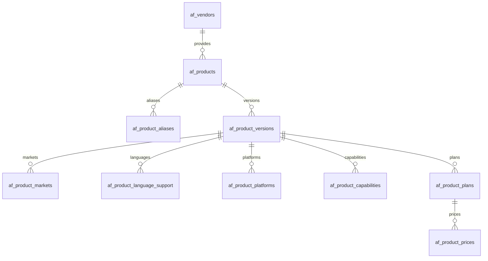

# AIFIND Phase 1 — Product Domain 完成报告

日期：2026-10-05。范围：纯 Product Domain。最终 Phase 2 Gate：**READY**。完成后停止，未开始 Phase 2。

本报告依据本轮实际代码、数据库迁移/约束执行、TDD 日志、最终完整回归、独立源码审查和逐路径哈希对照。实施计划先于代码保存并自检。既有日本化、品牌、内容策略和 Phase 0.6 test harness 没有修改。

本轮证据目录：[phase1 evidence](D:/Projects/aihot/.data/phase1-20261005123410132-3e92fe)。该目录保持 Git ignored，不提交 `.data/` 或密钥。

## A. Architecture

PostgreSQL 是唯一正式数据源。新增 `modules/aifind`，通过 `site/modules/server.ts` 注册 name-only server module；没有新增 HTTP handler、页面、worker job、schedule、SEO/public/Agent 出口。框架没有反向导入 AIFIND。Product 与现有新闻 entity/topic/event 没有合表或建立 resolver 映射。



Vendor 为可空关系；图中产品可以没有 vendor。`af_evidence` 被 version lifecycle 和六类事实引用，可跨版本复用；证据记录本身不可修改/删除。事实、plan、price 属于版本；克隆只共享不可变 evidence 引用，不共享可变事实行。

| 实际表 | 核心字段与约束 |
|---|---|
| `af_vendors` | text id；唯一稳定 slug；name/legal_name/official_url/country_code；status=unknown/active/inactive；created_at/updated_at |
| `af_products` | text id；nullable vendor_id FK；全局唯一稳定 slug；canonical_name；created_at/updated_at；不存价格或能力 |
| `af_product_aliases` | id/product_id；原 alias + normalized_alias；locale/alias_type；created_at；unique(product_id, normalized_alias)；跨产品歧义可保留 |
| `af_product_versions` | id/product_id/version_no；draft/published/superseded；display_name/official_url/lifecycle_status；lifecycle_evidence_id/lifecycle_verified_at；created_at/created_by/published_at/superseded_at |
| `af_product_markets` | id/product_version_id/market_code；availability_status；verified_at/evidence_id；unique(version, market) |
| `af_product_language_support` | PK(version, language)；input_support/output_support/ui_support 独立；verified_at/evidence_id |
| `af_product_platforms` | PK(version, platform_key)；unknown/available/unavailable；verified_at/evidence_id |
| `af_product_capabilities` | PK(version, capability_key)；unknown/none/partial/full；verified_at/evidence_id；受控能力字典，无 EAV |
| `af_product_plans` | id/version/plan_key/name；audience/billing_model/active_status；verified_at/evidence_id；unique(version, plan_key) |
| `af_product_prices` | id/plan_id；nullable market/currency；billing_period/price_type；bounded bigint amount_minor；unit_label/valid_from/valid_to；verified_at/evidence_id |
| `af_evidence` | id/url/title/publisher/source_kind；retrieved_at/published_at；content_hash/evidence_note/created_at；metadata + 最多 500 字短说明，无全文 |

ID 复用现有 `newUuid()`，持久化 text；时刻使用 timestamptz，价格有效日期使用 date。全部外键使用 `ON DELETE RESTRICT`。不存在删除全部历史的 cascade primitive。Partial unique index 实际保证每个 Product 最多一个 draft、一个 current published；unique(product_id, version_no) 保证序号。

数据库 trigger 禁止改写 published/superseded 版本及其事实；唯一允许的历史状态变更为 published → superseded。各事实写入锁定所属 version，禁止 ownership 重挂。证据 append-only。发布写事务必须为 **Read Committed**；读取聚合为 **Repeatable Read read-only**。二者职责不同，后者不会发布。

## B. Files

新增模块共 **31 个文件**：

```text
modules/aifind/
  package.json
  server.ts
  contracts.ts
  catalog/
    normalize.ts
    identity.ts
    versions.ts
    evidence.ts
    facts.ts
    pricing.ts
    read.ts
    verification.ts
    publish.ts
  publication/
    products.ts
  migrations/
    0062_aifind_identity.sql
    0063_aifind_versions.sql
    0064_aifind_evidence.sql
    0065_aifind_markets_languages_platforms.sql
    0066_aifind_capabilities.sql
    0067_aifind_plans_prices.sql
    0068_aifind_publication_guards.sql
    0069_aifind_publication_isolation.sql
  tests/
    fixtures.ts
    module.test.ts
    identity.test.ts
    versions.test.ts
    evidence.test.ts
    facts.test.ts
    pricing.test.ts
    publication.test.ts
    publish.test.ts
    migrations.test.ts
```

contracts 只依赖 Zod，数据库 row 与 DTO 分离；read 负责聚合/allowlist；verification 共享明确事实判定；publish 保持纯事务。测试使用合成 fixture，没有真实产品 seed。

既有文件只修改四处，均有本轮修改前的精确备份：

| 文件 | 实际修改与原因 |
|---|---|
| [site/package.json](D:/Projects/aihot/site/package.json) | 加入 `@aihot/aifind: *` workspace dependency |
| [site/modules/server.ts](D:/Projects/aihot/site/modules/server.ts) | append `aifindServer`；原三个模块和顺序保留 |
| [Dockerfile](D:/Projects/aihot/Dockerfile) | npm ci 前 COPY 新 workspace package.json；沿用现有多 workspace 镜像模式 |
| [package-lock.json](D:/Projects/aihot/package-lock.json) | 离线更新 workspace/link 元数据；所有既有包 version/resolved/integrity 均未变；没有新增外部依赖或升级 |

新增计划与本报告：[实施计划](D:/Projects/aihot/docs/superpowers/plans/2026-10-05-aifind-phase1-product-domain.md)、本文件。没有修改 generic framework、旧迁移、旧测试、frontend、品牌、navbar、Sources、Prompts、selection threshold 或日报 08:00 周期。

## C. Migration

现有 migration discovery 已能发现 `modules/<name>/migrations/*.sql`，无需框架扩展。本阶段只追加：

| 新文件 | 内容 |
|---|---|
| `0062_aifind_identity.sql` | Vendor/Product/Alias、稳定 slug 和 FK |
| `0063_aifind_versions.sql` | 版本、partial unique、历史不可变与事实写入锁/归属 guard |
| `0064_aifind_evidence.sql` | Evidence metadata、不可变证据和 lifecycle 核验字段 |
| `0065_aifind_markets_languages_platforms.sql` | market、三维语言支持、平台及 draft guards |
| `0066_aifind_capabilities.sql` | 受控 capability + support level |
| `0067_aifind_plans_prices.sql` | plan/price 分离、整数金额和 price shape CHECK、draft price guard |
| `0068_aifind_publication_guards.sql` | lifecycle 与六类明确事实的证据/核验时间发布门槛 |
| `0069_aifind_publication_isolation.sql` | 独立审查发现旧写快照绕过后追加的 isolation guard；不改已应用 0068 |

实际结果：**58 个原迁移 + 8 个新迁移 = 66 个迁移共存；11 张 af_ 表**。`migrations.test.ts` 从真正空库新建随机 `af_migration_*_test`，逐项比较实际 schema_migrations 与全部 core/module SQL 文件，再跑第二次确认 `database is up to date`。并未把已有 template 当空库。

同一测试实际验证 orphan FK 拒绝、RESTRICT 删除、所有事实 ownership 不可重挂、published/superseded 不可变、没有孤儿 Version/Plan/Price。P01/P02/P07 和 versions 测试实际触发 unique/partial unique。Fixture 表与设置只存在该文件的独立 test copy，结束清理；迁移空库结束删除。**没有在生产数据库执行 migration 或写入产品。**

## D. Domain Interfaces

以下是现有 ESM module export，可供后续 Admin/API 调用；不等于本阶段上线 HTTP endpoint：

| 模块 | 主要函数/contract |
|---|---|
| `catalog/identity.ts` | `createVendor(input)`、`getVendor(id)`、`updateVendor(id,input)`；`createProduct(input)`；`addProductAlias(productId,input)`、`listProductAliases(productId)` |
| `catalog/normalize.ts` | `normalizeAlias(alias)`：NFKC + trim + lowercase + 空白合并；不做模糊 resolver |
| `catalog/versions.ts` | `createProductDraft(productId,input,createdBy?)`；`clonePublishedProduct(productId,createdBy?)`；`updateProductDraft(productId,versionId,input)`；`getDraftProduct(productId)` |
| `catalog/evidence.ts` | `createEvidence(input)`、`getEvidence(id)`；纠正证据建立新记录 |
| `catalog/facts.ts` | `setProductMarket/LanguageSupport/Platform/Capability(productId,versionId,input)`；仅编辑 draft |
| `catalog/pricing.ts` | `saveProductPlan(productId,versionId,input)`；`saveProductPrice(productId,versionId,planId,input)`；有 price id 为替换，无 id 为新增独立价格组件 |
| `publication/products.ts` | `getPublishedProductBySlug(slug): Promise<PublishedProduct|null>`；`listPublishedProducts({limit?,offset?}): Promise<PublishedProduct[]>`；limit 1–100，默认 20；offset 非负整数 |
| `catalog/publish.ts` | `publishProductVersion(productId,versionId,actor,reason): Promise<PublishedProduct>`；显式 Read Committed、锁/归属/draft 检查/验证/状态切换/审计同事务 |
| `contracts.ts` | `Vendor`、`ProductIdentity`、`ProductAlias`、`VersionMetadata`、各事实/Plan/Price/Evidence DTO；`PublishedProduct` / `DraftProduct` 分别声明版本状态；严格 Zod 输入校验 |

PublishedProduct 合成 identity、vendor、aliases、version、markets、languages、platforms、capabilities、plans + prices、引用的 evidence metadata、lastVerifiedAt。不暴露 private createdBy。没有模糊 `getProduct()` 接口；Draft 读取另有明确命名。

计划中已明确决定实现 publish primitive，因为原子替换、失败回滚和证据验证是可直接验收的 domain 保证。沿用现有 audit helper，在事务中记录 actor/reason/before/after；没有预建 Review Queue、outbox 或 Admin。未来 Admin 在调用边界负责鉴权与人工复核。

## E. P01–P24

全部适用，全部 PASS。以下测试在最终 full suite 中实际执行；路径均在 `modules/aifind/tests/`。

| ID | 状态 | 测试文件 | 实际验证 |
|---|---|---|---|
| P01 | PASS | identity.test.ts | Vendor slug 唯一，名称可改，slug 改写被拒绝 |
| P02 | PASS | identity.test.ts | Product slug 跨 Vendor 全局唯一、稳定 |
| P03 | PASS | identity.test.ts | NFKC/大小写/空白 normalization 稳定且幂等；原 alias 保留 |
| P04 | PASS | versions.test.ts | draft-only 的 published detail 返回 null |
| P05 | PASS | versions.test.ts | v2 draft 存在时仍只读取 v1 published |
| P06 | PASS | versions/publication/pricing/facts.test.ts | 六类事实、lifecycle、价格的草稿编辑均不改变 published；克隆 mutable IDs 不共享 |
| P07 | PASS | versions.test.ts | DB partial unique 拒绝两个 current published |
| P08 | PASS | facts.test.ts | unknown 与 unavailable 分开保存/读取 |
| P09 | PASS | facts.test.ts | 日语 input=full/output=full/UI=none 合法且独立 |
| P10 | PASS | facts.test.ts | 缺 Android 行投影 unknown，无伪造 unavailable |
| P11 | PASS | facts.test.ts | capability unknown 与 none 分开 |
| P12 | PASS | facts.test.ts | 非法 capability key 被 Domain 和 DB 拒绝 |
| P13 | PASS | pricing.test.ts | free 必须 amountMinor=0；正数及 SQL NULL 被拒绝 |
| P14 | PASS | pricing.test.ts | unknown 必须 NULL，不能 0 |
| P15 | PASS | pricing.test.ts | custom 必须 NULL，保留独立类型，不能 0 |
| P16 | PASS | pricing.test.ts | fixed/from 必须受控币种 + 正整数金额；缺值/0/垃圾币种拒绝 |
| P17 | PASS | pricing.test.ts | bigint minor units 的 1999 和 MAX_SAFE_INTEGER 精确往返；小数/负数/不安全整数拒绝 |
| P18 | PASS | publish.test.ts | free/fixed/from/custom 全部要求 evidence 和 verifiedAt 才能 published |
| P19 | PASS | publish.test.ts | available/unavailable/waitlist/restricted 全部要求证据与核验时间 |
| P20 | PASS | publish.test.ts | 所有 unknown 和 unknown price 可无证据发布；lastVerifiedAt 为 NULL |
| P21 | PASS | publication.test.ts | published detail/list 不返回 draft/superseded，分页固定顺序，无 createdBy |
| P22 | PASS | publish.test.ts | old published→superseded，draft→published，audit 同事务提交 |
| P23 | PASS | publish.test.ts | 验证失败或新版本切换时 DB trigger 故障：旧 published、draft、audit 原样回滚 |
| P24 | PASS | publication.test.ts | lastVerifiedAt 取可信明确事实最大 verified_at，忽略 updated_at、unknown 时间和较新 draft |

另有真实数据库测试：跨产品 version/plan/price 拒绝，HTTP(S)/slug/currency/market/language 校验，生命周期和六类事实可信门槛，证据不可变，valid_from/to 顺序，串行并发发布、编辑期间发布等待，以及旧 Repeatable Read 快照绕过回归。

## F. Full Regression

下表是审查修复后的本轮最终执行，不是 Phase 0.6 的旧日志：

| 检查 | 状态 | Total | PASS | FAIL | CANCELLED | SKIPPED | 本轮日志 |
|---|---|---:|---:|---:|---:|---:|---|
| `npm run typecheck` | PASS | — | — | — | — | — | final-typecheck.log，exit 0 |
| 完整 `npm test` | PASS | **748** | **740** | **0** | **0** | **8** | final-full.log，exit 0 |
| AIFIND module targeted tests | PASS | 54 | 54 | 0 | 0 | 0 | isolation-green.log，exit 0 |
| `npm run build -w @aihot/web` | PASS | — | — | — | — | — | final-web-build.log，exit 0 |
| `node --test apps/web/tests/*.test.ts` | PASS | 33 | 33 | 0 | 0 | 0 | final-web-tests.log，exit 0 |
| 本机启动后的 smoke | UNRUN | — | — | — | — | — | 本阶段未启动 API/Web；没有新 public route，未把此项声称 PASS |
| Docker image build | UNRUN | — | — | — | — | — | 本轮未构建容器；只完成 workspace 接入及 Web build/tests |

完整套件最终执行时间：2026-10-05 14:01:01.942Z → 14:03:03.118Z。PS 7.6.5、Node 24.14.0、Windows；复用本机已有 PostgreSQL client **17.11** 的 pg_dump/pg_restore，未安装系统软件。测试入口指定 `aifind_phase1_test`，每个文件由原 harness 建立独立 `*_test` copy；空库 migration test 再新建自己的 `af_migration_*_test`。

父进程设置 COLLECT/MODEL_CALLS/FEISHU_CONTENT_PUSH/FEISHU_INTERNAL/INDEXNOW_SUBMIT 全部 false，清除真实 OpenAI key/base URL。原 Phase 0.6 test setup 仍允许本地 fake model 并通过网络拦截阻止真实外网；本阶段没有修改生产安全阀或 harness。Product Domain 本身无外部 fetch/模型/采集/推送路径。

与 Phase 0.6 的 **694/686/0/0/8** 逐测试名、深度、状态和 skip reason 做 multiset 比较：原 **686 PASS 全部保留**，原 **8 SKIPPED 全部保留且原因一致**，新增 **54 PASS**，没有新增 skip、missing 或 changed status。比较结果与所有当前测试名保存为 `baseline-comparison.json` / `current-test-names.json`；以后以 `phase1-baseline.json` 和本轮 final-full.log 为基线。

保留的 8 个 Windows skip（未删除或放宽测试）：

| 测试名称 | 原因 |
|---|---|
| SIGTERM during the final paid writing call still commits the complete analysis and publication | Windows 不传递 POSIX SIGTERM，Linux CI 覆盖 |
| SIGTERM during successful first score drains slower structure and leaves a retryable job | POSIX SIGTERM，Linux CI 覆盖 |
| SIGTERM during failed first score drains slower structure and leaves a retryable job | POSIX SIGTERM，Linux CI 覆盖 |
| packing retries once and a successful retry preserves the screenshot | POSIX shell executable fixture，Linux CI 覆盖 |
| persistent packing failure still sends the database and reports incomplete backup | POSIX shell executable fixture，Linux CI 覆盖 |
| an unreadable upload directory cannot become a successful empty backup | POSIX symlink-loop fixture，Linux CI 覆盖 |
| SIGTERM finishes the sent normal batch and resumes from its receipt | POSIX SIGTERM，Linux CI 覆盖 |
| SIGTERM finishes the sent misaligned batch and resumes from its receipt | POSIX SIGTERM，Linux CI 覆盖 |

TDD 过程也留存了真实失败证据：identity RED 5 FAIL、versions 6、evidence 3、facts 6、capabilities 2、pricing 7、publication RED-v2 4、publish 10，然后各阶段 GREEN。publication 首轮新 fixture 遗漏 after(closeDb) 的进程关闭 hook，终止该测试进程后补 hook 并重跑 RED-v2；没有使用该中断日志作通过结果。

## G. Draft/Published Proof

Published detail/list SQL 的谓词明确为 `v.status='published'`，整次聚合在一个 Repeatable Read read-only snapshot 内完成。没有注册任何 Product public endpoint，不存在读者直接 DB 或请求触发模型。

P04/P05/P21 分别证明 draft-only 返回 null、旧 published 与新 draft 共存时返回旧版本、列表与详情均排除 draft/superseded。P06 的完整 fixture 修改 lifecycle、JP availability、日语三个维度、platform、capability、plan/price 后，published aggregate 仍 deepEqual 原结果，证据集合也不包含仅被草稿引用的新 evidence。克隆后的 market/plan/price ID 为新值；直接 SQL 改写/删除 published/superseded 数据被拒绝。

## H. Price Semantics Proof

P13–P17 的 Domain + DB 回归锁定：

| 类型 | amount_minor | 规则 |
|---|---|---|
| unknown | NULL | 不能 0，不能解释为免费 |
| free | 0 | 必须非 NULL、恰好 0，不能正数 |
| custom | NULL | 保留联系销售语义，不能 0 |
| fixed / from | 正整数 | 币种必填且受控；缺金额/缺币种/0 拒绝 |

数据库为 bigint，CHECK 范围 `0..9007199254740991`；Domain 为整数且不超过 MAX_SAFE_INTEGER。因共享 DB helper 将 int8 转 Number，本模块明确收紧整数上限以保证精确，不改全局 parser。1999 和上限均与 `amount_minor::text` 及 DTO 一致；19.99、小数、负数、越界拒绝。没有字符串美元解析或浮点主币种换算路径。月/年、JP/US 价格独立；跨产品 plan/price 拒绝；价格日期使用 date→text，保留日期语义。

## I. Evidence Proof

P18/P19 分别遍历全部明确 price/availability 状态，缺 evidence 或 verifiedAt 都不能进入 published。其他测试同时检查 lifecycle、language、platform、capability、plan；正面和明确负面都要求证据，不仅是 full/available。P20 的 unknown 可无证据发布。

DB 0068 也检查同一门槛，防直接 SQL 绕过；FK 保证引用存在，append-only evidence 保持历史可追溯。公开 DTO 只聚合当前选择版本实际引用的 metadata，不包含其他产品/草稿无关证据或全文。`lastVerifiedAt` 只取明确事实且 evidence 存在的 verified_at 最大值；unknown 行即便带未来时间，也不能推进 freshness。

### 独立审查发现与修复

一次 fresh-context 只读源码审查结果：Critical 0、Important 1、Minor 0。发现直接 SQL writer 在旧 Repeatable Read snapshot 下可能遗漏后来提交的无证据事实。初审该案例是 source-derived/UNRUN；随后本轮用真实双会话复现。

`isolation-red-v2.log`：8 项，5 PASS / 3 FAIL，分别锁定旧快照发布、Serializable 未拒绝、数据库默认 Repeatable Read 时 Domain 实际也用了该隔离级别。第三项用新子进程新连接和测试 trigger 观察实际 transaction_isolation，不是检查源码字符串；第一版错误使用 reserved connection 的 begin API 已在 fixture 修正后重新得到有效 RED。

修复：publish 原语显式 `sql.begin('isolation level read committed', ...)`，另追加 0069，在 DB 进入 published 时拒绝其他 isolation，避免证据门槛读取旧写快照。读取仍保持 Repeatable Read read-only。已应用的 0062–0068 没有改写。

`isolation-green.log` **54/54 PASS**，最终完整 suite **748/740/0/0/8**；Important 已由本轮 RED→GREEN 和完整回归关闭。按执行计划只进行一次完整审查、一次重要问题修复，不声称有第二次独立复审。完整审查及关闭记录见 `.data/.../final-review.md`。没有未解决 Important/Critical，也没有 deferred minors。

## J. Git Safety

Phase 1 前保存 HEAD/index/status、**816 个原 tracked/nonignored untracked 路径**的 hash（包括 MISSING 状态）、四个接入文件备份、Phase 0.5/0.6 引用与当前 hash；最终再次对照。

| 检查 | 实际结果 |
|---|---|
| 原路径 | 812 个字节不变；4 个计划内接入修改；丢失 0；意外修改 0 |
| Phase 0.5 | 31 个原修改文件 + 8 个新增文件，共 39 个保护路径，本阶段全不变 |
| Phase 0.6 | 140 个 baseline 文件全不变，包括 setup、网络安全 guard、processing recovery 和 setup-safety 测试 |
| 旧 migration | 全部 58 个字节不变，包括 core 0055–0061 |
| HEAD | 始终 `9848e936106db037d99a304887c36aad3fd0fad4` |
| index SHA256 | 始终 `647cea9c84a71ae8002dc0bf17f59b2c704cdeedaf98c6b161415c9ffd1f4ccf` |
| branch | 保留 `codex/ai-signal-jp` 和原工作树 |
| `.env` | hash 不变，未在报告或日志输出秘密内容 |
| 锁文件既有依赖 | version/resolved/integrity 改动 0；只新建 modules/aifind 与 node_modules/@aihot/aifind workspace 条目 |
| 字体与其他旧工作 | 修改/删除状态按原 manifest 保留，未恢复 SC 字体，也未删原 untracked 文件 |

没有执行 reset、clean、checkout/restore 覆盖、stage、commit、merge、push 或工作树清理。四个接入文件均从本轮开始时的实际版本做局部追加，不用 Git HEAD 覆盖。Phase 1 的独立 diff、全部前后 hash 和 Git Safety JSON 保存在证据目录；工作树与证据保留供审阅。

## K. Known Limitations / Rulings

以下是已明确的阶段边界：没有 Admin/Review Queue UI、public product page/API、Compare、Category/Best、How-to、Affiliate、Newsletter、Search 重构、Resolver/Change Detector、自动事实抽取或真实产品 seed。没有 WordPress/CMS、其他数据库、Redis、搜索引擎、前端框架迁移或微服务。没有生产部署/生产 migration。

受控 V1 字典目前覆盖 market/country JP、US，language ja、en，currency JPY/USD/EUR/GBP。并非任意 ISO 输入；未来扩展通过 domain/contracts + forward migration。没有证据自动权重或官方/媒体覆盖算法，没有产品事实过期调度；这些没有声称完成。Published facts 不可直接修改，后续应 clone→edit→review→publish；当前发布 primitive 自身不提供 HTTP 鉴权流程。

本轮明确采用的决策（与 ledger 对应）：

1. 在原脏分支/工作树原地执行，保留 HEAD/index、不提交；因为 clean HEAD worktree 会漏掉已有日本化。代价：后续提交需明确拆分旧工作和本轮 diff。
2. 使用原生 PS7/Node runner 与持久化 ledger/hash/log，不用 POSIX helper、也不删除证据。代价：验收引用本地证据包而不是技能 helper 的 Git commit 范围。
3. publication 与 publish 测试分文件，verification 独立共享明确事实判断。代价：比初始文件图多少量模块内文件，避免 reader/publisher 判定漂移。
4. 发布只支持显式 Read Committed；读取保留 Repeatable Read read-only。代价：未来直接 SQL caller 不能在 RR/Serializable transaction 发布；Domain 自动选取正确级别。
5. 审查修复另加 0069，不改已应用 0068。代价：多一个 forward migration，保留已经测试/应用的迁移历史。

Deferred minors：无。Smoke、Docker image build 未运行，已如实列为 UNRUN；本阶段要求的四项门禁均已最终通过。

## L. Phase 2 Gate

**READY**。

理由：模块边界成立；Vendor/Product/Alias 与 version-owned 全部事实已建立；P01–P24 全 PASS；明确证据、整数价格、unknown/negative、published/draft 隔离和原子回滚具备真实数据库证明；审查 Important 已修复；最终 full suite 0 FAIL/0 CANCELLED，原 686 PASS 和 8 skips 均保留；typecheck/Web build/tests 通过；旧工作保护检查通过。Phase 2 可依赖本轮 domain interfaces 和新基线。

仅表示 Phase 2 的开发准备就绪。**本轮到此停止，没有自动开始 Phase 2。**
